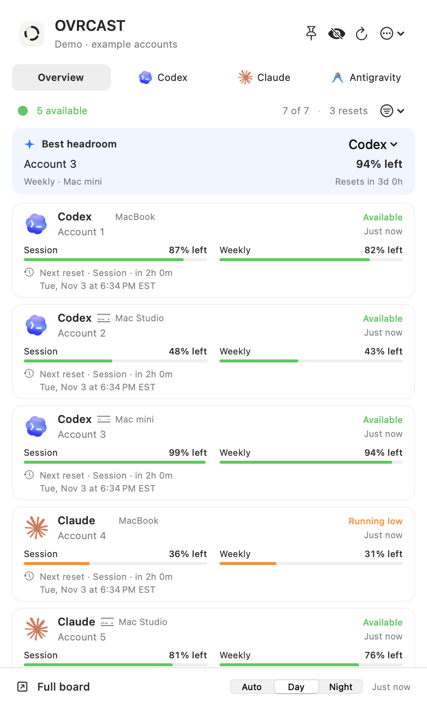

# OVRCAST

Previously named Usage Board. Existing accounts and settings carry over;
internal `UsageBoard` storage paths and the `usageboard://` link remain compatible.

**Your AI capacity, at a glance.**

A free, local macOS menu bar app for seeing how much AI usage you have left
across accounts and Macs. Built with SwiftUI, AppKit and Python.

Created by **Git**. An independent project with its own segmented capacity-ring icon and interface,
with its own bundled collector derived from [CodexBar](https://github.com/steipete/CodexBar)’s MIT-licensed source.



## Features

- One compact overview for Codex, Claude and Antigravity accounts.
- Clear MacBook, Mac mini and Mac Studio labels, including in privacy mode.
- Session, weekly and model allowances, with next-reset countdowns and exact local times.
- Recognizable Codex, Claude and Antigravity identification icons.
- Saved-reset inventory and separate credit pools when a source reports them.
- Day and Night appearance, provider tabs, machine/status filters and usage sorting.
- A pinned floating board: drag the native title bar to move it, or unpin it
  to return to the menu bar dropdown. Position and preferences persist.
- Detailed account views and a full local HTML dashboard.
- Explicit stale, missing and signed-out states; cached quotas are marked last known.
- Verified first-run setup, per-connection health, optional signed updates, and
  independent refreshes with automatic failure backoff and wake/network recovery.
- Recoverable settings, visible save failures and regression checks on Intel and Apple Silicon.
  See the [reliability review](docs/RELIABILITY.md) for scope and remaining validation.

OVRCAST is free software under the [MIT license](LICENSE). There is no
OVRCAST subscription. Provider accounts and their usage remain subject to
the respective provider's terms and charges.

## Install the app

The native app runs on macOS 14 or later on Apple Silicon or Intel. Unzip the
download, then drag OVRCAST into Applications. It does not need Python, Terminal,
a development folder or a separate OVRCAST account.

[Download OVRCAST for macOS](https://github.com/gitdot5/OVRCAST/releases)

The latest published release is **0.4.3**. This branch prepares **0.5.0**, held for
the checks in [the candidate review](docs/NEXT_RELEASE.md).

OVRCAST includes an OVRCAST-maintained collector compiled from a pinned
CodexBar v0.81.0 source fork. **No separate CodexBar installation is required.**
The collector, its runtime resources and license notices ship inside OVRCAST.
Updates to this fork ship with OVRCAST releases; upstream changes are reviewed
and imported deliberately. Version 0.5.0 adds optional signed in-app updates;
0.4.x must be updated manually once. Automatic checks and installation start off.
See [update security and recovery](docs/UPDATES.md). See the [release review](docs/RELEASE_REVIEW.md)
for the exact validation scope and known limits.

On first launch, Settings → Connect reports whether the built-in collector is
ready. Choose Connect Codex, Claude or Antigravity, complete the provider’s own
sign-in, then choose Check for that provider. Setup finishes only after a current usage
reading arrives for at least one selected provider. Codex and Antigravity use their official
app/CLI connections; Claude uses Claude Code OAuth. Connect Claude opens the
installed Claude Code login command in Terminal, or its setup documentation if
it is missing. A Claude Desktop sign-in alone may not supply this usage connection.
OVRCAST never asks for a pasted token. Existing provider sessions may work;
CodexBar-specific token-account configuration is not silently imported.

## Everyday controls

- **Pin:** keep the compact board floating; drag the title bar to move it.
- **Command-Shift-U:** show or hide it. Disable the shortcut in Settings if needed.
- **Eye:** hide identities, aliases, custom computer names and balances, including exports. Mac types stay visible.
- **Settings → Personalize:** friendly account names and System / Day / Night.
- **Best headroom:** compare current allowance within the selected provider and
  window. Shared limits still constrain a model selection; duplicate accounts
  on multiple Macs count once. This is not a task-completion prediction.
- **Account details:** connection help, separate credit pools, and seven days of
  measured local history. Unknown source fields stay unknown.
- **Settings → Alerts:** opt into low-usage, confirmed-reset and explicit credit
  expiry alerts, with a threshold, quiet hours and snooze. Alerts omit identities.
- **Settings → Health:** see each connection’s last successful reading, state and
  next retry. Manual Retry bypasses the automatic failure backoff.
- **Review support report:** preview, copy or save a structured report without
  account IDs, emails, computer names, aliases, balances or raw errors. Nothing is sent.
- **Settings → Personalize:** opt into capacity in the menu bar or estimates based
  on recent local history. Forecasts stay hidden when readings are stale, too sparse,
  discontinuous or span a reset; they never promise that a task will finish.

## Other computers

Install OVRCAST on each Mac and connect its providers there. Add an existing
trusted SSH alias in Settings → Computers. This flow does not configure SSH or
Remote Login, approve unknown host keys, copy credentials, or discover computers
automatically. Each app must be running for its local readings to stay current.
The board marks unavailable computers and stale readings explicitly.

## Existing scripted installations

An existing `~/usage_board/config.local.json` keeps the original Python/SSH
collector active. That path preserves established fleet collection and source
settings. The new UI can read those snapshots. Settings → Connect explicitly
switches to built-in collection; it does not remove the old background jobs.
Remove those jobs yourself before replacing their schedule.

See [configuration and troubleshooting](docs/SETUP.md) for the legacy collector,
SSH requirements and optional isolated Claude profiles.

## Data and privacy

The [distribution privacy review](docs/DISTRIBUTION_PRIVACY_REVIEW.md) records
checks of public downloads and source history. Provider credentials and private
usage snapshots are not distributed. Each user connects their own accounts.

There is no OVRCAST usage backend, telemetry or listening server. Optional update
checks contact GitHub for signed release metadata and packages; GitHub receives
normal connection metadata, but no provider credentials or usage snapshots.
System-profile fields are disabled. Provider tools
may contact their services to obtain usage. Remote collection, when configured,
uses your existing SSH access. Snapshots contain account emails, usage limits,
reset dates and reported credit balances; they are private local files.

The native and legacy collectors invoke the OVRCAST-owned bundled helper. The legacy Python collector also parses
usage-limit events from Codex logs.
Neither starts model turns, redeems resets or buys credits. Credential-pattern
checks are a precaution, not a guarantee that arbitrary upstream output is safe
to publish. Do not share your local config, snapshots, generated dashboard or logs.

## Develop

```sh
/usr/bin/python3 -m unittest discover -s tests
swift test --package-path native -j 2
./script/build_and_run.sh --build-only
```

Tests use example account identities and fixed parser samples. They are not live
provider checks. The optional legacy Python code uses the standard library; the GUI pins Sparkle 2.10.1 (including its binary checksum through SwiftPM). The collector’s Commander,
SweetCookieKit and swift-log source dependencies are pinned locally in `vendor/`
with their licenses. The first GUI build downloads the pinned Sparkle package;
collector dependencies remain local.
Building requires a Swift 6.2+ toolchain with the macOS SDK and Python 3.9+
for packaging scripts. The built app requires neither Python nor a compiler.

`./script/build_and_run.sh` builds and opens the local app; `./app/install_app.sh`
backs up an existing local app and installs the new one.
`./script/package_release.sh` builds a clean universal preview DMG from the
source allowlist, without private images or data. Set `DEVELOPER_ID` and
`NOTARY_PROFILE` explicitly to use your own signing identity and a configured
notarytool Keychain profile. No credentials are bundled.

Preview arguments `--demo --snapshot /path/to/image.png --exit-after-snapshot`
render example accounts without reading live accounts. Add `--setup`, `--night`
or `--privacy` to inspect those states. App-owned previews require no screen
recording permission.

## Share the source

Follow the [public distribution checklist](docs/DISTRIBUTION.md) before posting
a download. Keep testing claims specific to the exact artifact and environment.

```sh
/usr/bin/python3 script/export_source.py
```

This produces `dist/OVRCAST-source.zip` from an explicit file allowlist and
scans first-party files for private identities, home paths, private hosts and
credential-shaped content. Vendored public upstream files use a frozen SHA-256
allowlist, preserving public author identities and notices without including local files. It excludes local config, state, build products, extracted third-party
artwork, historical private notes and all Git history. Publish the clean export
as a new repository; the original working checkout may have private history.

## License and credits

Original OVRCAST source and its segmented capacity-ring app icon are MIT licensed. CodexBar
supplies the MIT-licensed source used by our maintained collector fork and inspired
the provider/allowance layout.
Its copyright and license are preserved under [LICENSES](LICENSES/CodexBar-MIT.txt).
See [third-party notices](THIRD_PARTY_NOTICES.md) for scope and exclusions.
The [brand guide](docs/BRAND.md) describes the product identity and attribution.
