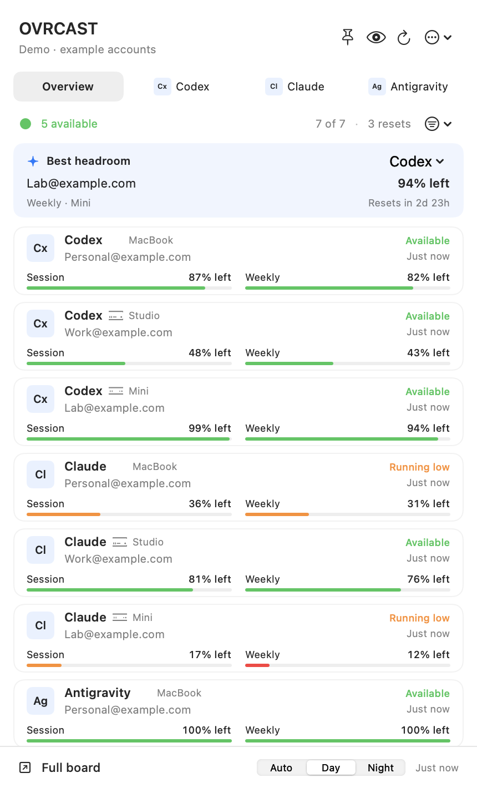

# OVRCAST

Previously named Usage Board. Existing accounts and settings carry over;
internal `UsageBoard` storage paths and the `usageboard://` link remain compatible.

**Your AI capacity, at a glance.**

A free, local macOS menu bar app for seeing how much AI usage you have left
across accounts and Macs. Built with SwiftUI, AppKit and Python.

Created by **Git**. An independent project with its own gauge icon and interface,
using [CodexBar](https://github.com/steipete/CodexBar) for usage collection.



## Features

- One compact overview for Codex, Claude and Antigravity accounts.
- Session, weekly and model allowances, with reset countdowns.
- Saved-reset inventory and separate credit pools when a source reports them.
- Day and Night appearance, provider tabs, machine/status filters and usage sorting.
- A pinned floating board: drag the native title bar to move it, or unpin it
  to return to the menu bar dropdown. Position and preferences persist.
- Detailed account views and a full local HTML dashboard.
- Explicit stale, missing and signed-out states; unknown balances stay unknown.

OVRCAST is free software under the [MIT license](LICENSE). There is no
OVRCAST subscription. Provider accounts and their usage remain subject to
the respective provider's terms and charges.

## Install the app

The native app runs on macOS 14 or later on Apple Silicon or Intel. Unzip the
download, then drag OVRCAST into Applications. It does not need Python, Terminal,
a development folder or a separate OVRCAST account.

[Download OVRCAST 0.3.0 for macOS](https://github.com/gitdot5/OVRCAST/releases/tag/v0.3.0)

This first public preview is Developer ID signed and Apple notarized. Its stapled
ticket, Gatekeeper assessment and packaged launch passed local checks. It runs on
Apple Silicon and Intel. CodexBar 0.81.0 was used for compatibility testing.
A separate-Mac installation test and independent security audit have not been
completed. See the [release review](docs/RELEASE_REVIEW.md) for the validation scope.
Older development previews are separate builds.

On first launch, the Connect screen detects the separately installed
[CodexBar](https://github.com/steipete/CodexBar) companion and opens its download
page if needed. Connect your accounts in CodexBar, choose providers, then check
the connection. Codex and Claude use CLI sources. Sign-in remains with your
provider; OVRCAST never asks for a pasted token.

## Everyday controls

- **Pin:** keep the compact board floating; drag the title bar to move it.
- **Command-Shift-U:** show or hide it. Disable the shortcut in Settings if needed.
- **Eye:** hide identities, aliases, computer names and balances, including exports.
- **Settings → Personalize:** friendly account names and System / Day / Night.
- **Best headroom:** compare current allowance within the selected provider and
  window. Shared limits still constrain a model selection; duplicate accounts
  on multiple Macs count once. This is not a task-completion prediction.
- **Account details:** connection help, separate credit pools, and seven days of
  measured local history. Unknown source fields stay unknown.
- **Settings → Alerts:** opt into low-usage, confirmed-reset and explicit credit
  expiry alerts, with a threshold, quiet hours and snooze. Alerts omit identities.
- **Copy support report:** export only provider/status counts and source health;
  no account IDs, emails, machine names, aliases, balances or raw diagnostic text.

## Other computers

Install OVRCAST on each Mac and connect its providers there. Add an existing
trusted SSH alias in Settings → Computers. This flow does not configure SSH or
Remote Login, approve unknown host keys, copy credentials, or discover computers
automatically. Each app must be running for its local readings to stay current.
The board marks unavailable computers and stale readings explicitly.

## Existing scripted installations

An existing `~/usage_board/config.local.json` keeps the original Python/SSH
collector active. That path preserves established fleet collection and source
settings. The new UI can read those snapshots. Settings → Connect explicitly
switches to built-in collection; it does not remove the old background jobs.
Remove those jobs yourself before replacing their schedule.

See [configuration and troubleshooting](docs/SETUP.md) for the legacy collector,
SSH requirements and optional isolated Claude profiles.

## Data and privacy

There is no OVRCAST backend, telemetry or listening server. Provider tools
may contact their services to obtain usage. Remote collection, when configured,
uses your existing SSH access. Snapshots contain account emails, usage limits,
reset dates and reported credit balances; they are private local files.

The native collector invokes CodexBar. The legacy Python collector also parses
usage-limit events from Codex logs.
Neither starts model turns, redeems resets or buys credits. Credential-pattern
checks are a precaution, not a guarantee that arbitrary upstream output is safe
to publish. Do not share your local config, snapshots, generated dashboard or logs.

## Develop

```sh
/usr/bin/python3 -m unittest discover -s tests
swift test --package-path native -j 2
./script/build_and_run.sh --build-only
```

Tests use example account identities and fixed parser samples. They are not live
provider checks. The optional legacy Python code uses the standard library; the Swift package
has no external package dependencies. Building requires Xcode Command Line Tools
with a Swift 5.9+ toolchain and Python 3.9+ for the packaging scripts.

`./script/build_and_run.sh` builds and opens the local app; `./app/install_app.sh`
backs up an existing local app and installs the new one.
`./script/package_release.sh` builds a clean universal preview DMG from the
source allowlist, without private images or data. Set `DEVELOPER_ID` and
`NOTARY_PROFILE` explicitly to use your own signing identity and a configured
notarytool Keychain profile. No credentials are bundled.

Preview arguments `--demo --snapshot /path/to/image.png --exit-after-snapshot`
render example accounts without reading live accounts. Add `--setup`, `--night`
or `--privacy` to inspect those states. App-owned previews require no screen
recording permission.

## Share the source

Follow the [public distribution checklist](docs/DISTRIBUTION.md) before posting
a download. Keep testing claims specific to the exact artifact and environment.

```sh
/usr/bin/python3 script/export_source.py
```

This produces `dist/OVRCAST-source.zip` from an explicit file allowlist and
scans it for private identities, home paths, private hosts and credential-shaped
content. It excludes local config, state, build products, extracted third-party
artwork, historical private notes and all Git history. Publish the clean export
as a new repository; the original working checkout may have private history.

## License and credits

Original OVRCAST source and its gauge app icon are MIT licensed. CodexBar
supplies the external collection CLI and inspired the provider/allowance layout.
Its copyright and license are preserved under [LICENSES](LICENSES/CodexBar-MIT.txt).
See [third-party notices](THIRD_PARTY_NOTICES.md) for scope and exclusions.
The [brand guide](docs/BRAND.md) describes the product identity and attribution.
